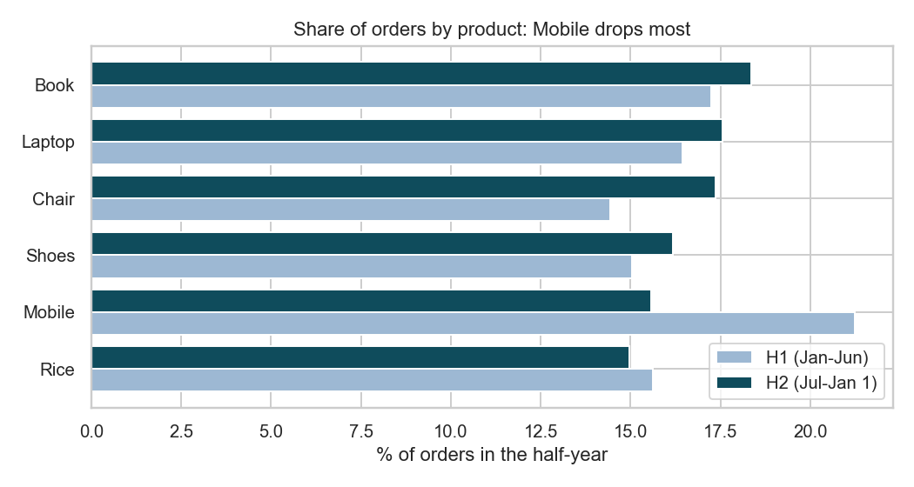
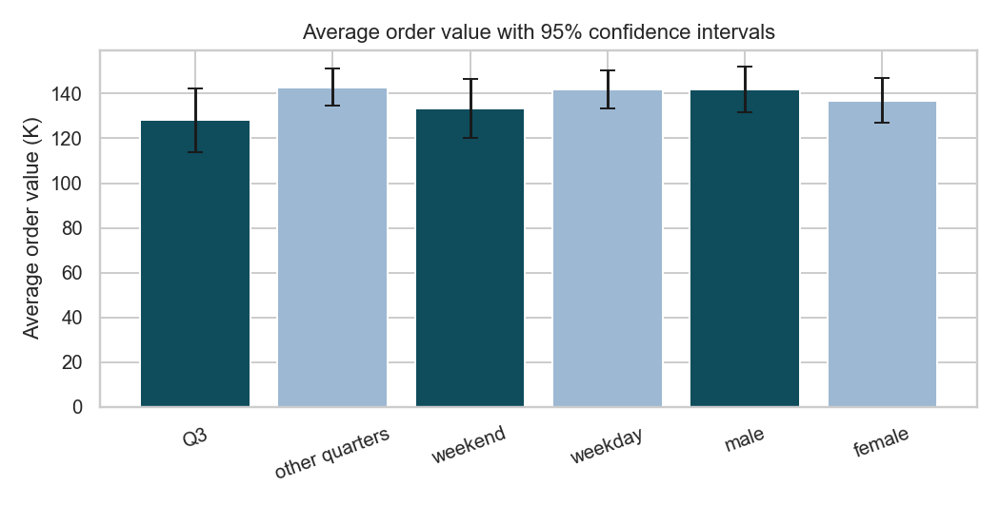

# Hypothesis Testing Summary

**Task 4 - Statistical Validation | ApexPlanet Data Analytics Internship | Author: Mahesh R**

Earlier tasks produced several findings from charts and tables (a Mobile decline, a Q3 dip, possible differences by gender or weekday). This summary tests them. Code: `src/hypothesis_tests.py`; raw output: `hypothesis_test_results.csv`.

## Method
- Significance level 5% (two-sided). Six tests were run, so p-values are **adjusted with the Holm method**; without this, running many tests makes a false positive likely.
- Order values are skewed, so each t-test was cross-checked with a Mann-Whitney test (same conclusions).
- Effect sizes and 95% confidence intervals are reported, because a p-value alone does not say how big or how certain a difference is.

## Results

| ID | Null hypothesis (H0) -> alternative (H1) | Test | Result | p (raw) | p (Holm) | Verdict |
|----|------------------------------------------|------|--------|---------|----------|---------|
| T1 | Product mix is the same in H1 and H2 -> it changed | Chi-square, product x half-year | chi2 = 6.38, df = 5, Cramer's V = 0.08 | 0.271 | 1.000 | No evidence the mix changed |
| T2 | Mobile's share of orders is the same in H1 and H2 -> it fell | Two-proportion z-test | 21.2% to 15.6% (106 to 78 orders); drop 5.7 pts, 95% CI 0.9 to 10.5 | 0.021 | 0.124 | Suggestive, **not confirmed** after correction |
| T3 | Q3 average order value equals other quarters' -> differs | Welch t-test | 128,163 vs 142,890; difference -14,727, 95% CI -31,144 to +1,691; d = -0.13 | 0.079 | 0.393 | Not significant |
| T4 | Weekend average order value equals weekday's -> differs | Welch t-test | 133,233 vs 141,894; difference -8,661, 95% CI -24,253 to +6,931; d = -0.08 | 0.276 | 1.000 | Not significant |
| T5 | Male and female average order values are equal -> differ | Welch t-test | 141,807 vs 136,883; difference +4,924, 95% CI -9,232 to +19,080; d = 0.04 | 0.495 | 1.000 | Not significant |
| T6 | Age and order value are uncorrelated -> correlated | Pearson correlation | r = 0.001 (Spearman -0.006) | 0.967 | 1.000 | No relationship |

Task 3 also tested whether the four order segments differ by demographics (chi-square): gender p = 0.55, age group p = 0.18, city p = 0.71, category p = 0.37. None is significant.

## Business conclusions
1. **Mobile's decline is a watch item, not a proven trend.** Its order share fell from 21.2% to 15.6% and the raw p-value is 0.021, but it was picked out after looking at the data, six tests were run, and after the Holm adjustment p = 0.124. The overall product mix did not change significantly (T1).
2. **The Q3 dip is not statistically established.** Q3 orders were about 15 k smaller on average, but the confidence interval includes zero (p = 0.079).
3. **Weekday, gender and age do not explain order value.** All three tests are far from significant, so marketing should not be built around these splits.
4. **"Not significant" is not "no difference".** With about 1,000 orders, the confidence intervals are wide: a gender or weekday gap of roughly 10-25 k per order cannot be ruled out. More data would sharpen these answers.

## Limitations
- T2 and T3 were chosen after exploring the data, so they are exploratory. A confirmatory test needs new data (for example, the next two quarters) with the decision rule set in advance.
- The data appears synthetic (evenly spread quantities and prices), and `Customer_ID` is unreliable, so orders are treated as independent observations.
- The 5 orders on 1 Jan 2026 are counted in H2 and Q1; excluding them does not change any conclusion.
